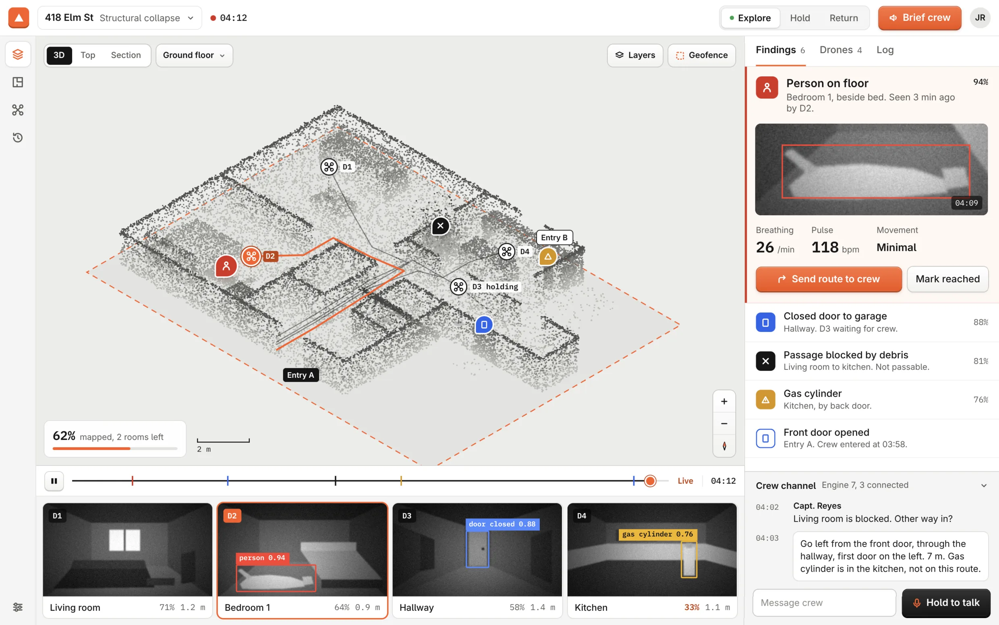

# Mayfly

CalHacks 13 submission. A search-and-rescue **drone swarm simulator**, plus the tooling to connect it to real hardware.

| | |
|---|---|
| Live web console | https://sonic-magenta-5w7whpr.tmp.now/ (reads the live mission from the GX10 through a tunnel) |
| Live simulator + 3D viewer | https://clouds-msg-diversity-serial.trycloudflare.com/ (served from the GX10) |
| If the live links are down | Both depend on a running sim and a tunnel, so they can be offline. The console then shows demo data. Run it yourself: [Quick start](#quick-start) |
| Sponsors used | [SpacetimeDB](https://spacetimedb.com) (all live state), [Presage](https://presagetech.com) (vitals, see the honesty notes) |



## What it does

A single central master computer orchestrates a swarm of drones over a lossy, delayed radio link. The drones fly into an
unknown collapsed building, build a 3D map of it together, find people with a YOLO detector, and rank them by urgency. A web
console and a 3D viewer show the whole mission live, in any number of browsers.

- **Simulator:** Python plus a Rust/CUDA core (`gpucore`, built with NVRTC, exposed through PyO3). It renders every drone's
  camera and fuses their depth into a TSDF map at 0.2 m. A frame-to-TSDF aligner and landmark planes limit pose drift, and dual
  contouring meshes walls flat and openings rectangular.
- **Radio model:** latency, jitter and packet loss between the drones and the master.
- **People and triage:** jointed human figures, found by a YOLO detector (`object_det/`). Each survivor gets a *simulated*
  vitals reading and an urgency tier.
- **Live state in SpacetimeDB:** the sim publishes drones, survivors, floor plans, the 3D point cloud and 15 fps camera feeds
  into one database. The viewer and console only subscribe, and play/pause/speed/reset go back through it as commands.
- **Web console** (`ui/apps/web`): mission setup, a live view with the 3D cloud and floor plans, a scrollable video feed per
  drone with a highlight on drones that are scanning a person, and a findings panel with vitals.
- **Real hardware** (`drone_control/`): an ESP32-S3 relay forwards an E58 drone's UDP video and 100 Hz IMU data. A live page shows
  the video and a tracked path, a flight handler with failsafes can command the drone, and a read-only publisher puts the real
  drone's status and video in the same database next to the sim.

## Honesty notes (read before judging)

- Everything in the live view is a **simulation**. The simulator is the main way to run Mayfly.
- **Vitals are simulated.** The real Presage SDK was tested only on rendered video clips with an injected pulse (`vitals/`).
  It needs a real face and shoulders shot, so it does not run on the simulated people.
- The **flight controller has been tested against a fake drone and has never flown the real drone.** Stick directions and RC
  mode are unverified on hardware.
- The real drone reaches the database only while the ESP32 relay board is attached and joined to the GX10's network.
- The IMU path is dead reckoning from a cheap sensor. It drifts, and is a demonstration, not navigation.

## Quick start

Needs Python 3.11+, and for the full simulator an NVIDIA GPU with CUDA (developed on an ASUS GX10, aarch64) and a Rust toolchain.

```bash
# 1. simulator (Python)
cd sim
python3 -m venv .venv && .venv/bin/pip install -e ".[dev]"      # add ".[gpu]" for the torch smoothing path
.venv/bin/uvicorn disaster_sim.server:app --port 8000           # http://localhost:8000 serves the 3D viewer

# 2. the viewer it serves (built once)
cd ../ui/viewer && npm install && npm run build

# 3. live state through SpacetimeDB (recommended): database, module, and the sim publishing into it
cd ../.. && scripts/stdb-up.sh        # needs the SpacetimeDB CLI and the wasm32-unknown-unknown Rust target

# 4. the web console, in dev mode (http://localhost:3001/live)
cd ui && bun install && cd apps/web && npx vite dev
#    pointing at a sim on another machine:  http://localhost:3001/live?stdb=ws://<sim host>:3000
```

Tests and a headless run:

```bash
cd sim && .venv/bin/python -m pytest -q
cd sim && .venv/bin/python -m disaster_sim.headless --seconds 600 --seed 1 --drones 6
cd drone_control && PYTHONPATH=.:tests pytest tests        # 54 tests: IMU tracker, flight handler, controller server, DB publisher
```

## Repository map

| Path | What is in it |
|---|---|
| `sim/disaster_sim/` | The simulator (Python). See the table below. |
| `gpucore/` | Rust + CUDA core (PyO3): camera rendering, depth fusion, TSDF map, alignment, mesher, radio |
| `object_det/` | YOLO person detector served on loopback `127.0.0.1:8765` (`serve.py`); the sim calls it |
| `swarm_db/spacetimedb/` | SpacetimeDB module (Rust): the `entity`, `bulk`, `event` and `cmd` tables and their reducers |
| `ui/apps/web/` | Web console: TanStack Start + React, `routes/` (landing, setup, live, fleet) and `components/live/` |
| `ui/viewer/` | Three.js 3D viewer (Vite); also embedded in the console as the point cloud (`?embed=cloud`) |
| `drone_control/` | Real hardware: `esp32/` relay firmware, `imu/` live page and path tracker, `control/` flight handler + HTTP API, `publish_db.py` |
| `vitals/` | Presage experiments: sample images, rendered clips, benchmark results |
| `scripts/` | `stdb-up.sh` (database + sim), `console-up.sh` (serve the built console) |

Simulator modules (`sim/disaster_sim/`):

| Area | Files |
|---|---|
| World and people | `building.py`, `entry.py`, `opening.py`, `materials.py`, `humans.py`, `floorplan.py` |
| Drones | `physics.py` (quadrotor dynamics), `control.py` (cascaded PID), `pilot.py`, `esp.py` |
| Sensing and mapping | `camera.py`, `rustcore.py` (bridge to `gpucore`), `gpu.py`, `voxelmap.py`, `surface.py`, `smoothing.py`, `align.py`, `estimation.py` |
| Radio | `comms.py`, `radio.py`, `packets.py`, `gcomms.py` |
| Master and planning | `master.py`, `planner3d.py` |
| People finding | `detector.py` (YOLO client), `presage.py` (simulated vitals) |
| Server and state | `sim.py` (the simulation loop), `server.py` (FastAPI), `protocol.py`, `stdb.py` (SpacetimeDB publisher), `config.py` |

## Live state through SpacetimeDB

With `STDB_URL` set, the simulator publishes everything the viewers show into a SpacetimeDB database named `swarm` (port 3000),
and the viewer and console read only from it, so any number of browsers see the same state. Without `STDB_URL` the viewer uses
the simulator's websocket instead (`?source=ws` forces this).

- **Tables:** `entity` (key, ver, text JSON, binary data), `bulk` (voxels, points, scan freshness, meshes, camera feeds),
  `event` (mission log) and `cmd` (commands from viewers). Reducers: `put`, `put_blobs`, `drop_keys`, `submit_cmd`, `clear_all`.
- **Keys the console uses:** `drone/<n>`, `plan/<floor>`, `feed/jpg<n>` (15 fps JPEG camera feeds), `real/status` and
  `feed/jpgreal` (the real drone).
- **Writes:** only the simulator's identity (token in `~/.swarm_stdb_token`) can write state. Viewers can only submit commands.
- **Commands:** `play`, `pause`, `speed`, `step`, `reset` and `select` (which drones' feeds to stream).
- `GET /stdb` on the sim server returns the publisher's counters. Regenerate the viewer's bindings after editing the module:
  `spacetime generate --lang typescript --out-dir ui/viewer/src/db/bindings --module-path swarm_db/spacetimedb`.
- The console finds the database at `?stdb=`, else the `VITE_STDB_URL` build variable, else `ws://<page host>:3000`. The viewer
  address works the same way (`?viewer=`, `VITE_VIEWER_URL`, else `http://<page host>:8000/`). The hosted console is built with
  both set to Cloudflare tunnels to the GX10 (a `wss://` address is required from an HTTPS page).

## Real drone

`drone_control/` connects real hardware, always next to the simulator and never instead of it. The sim stays the main path.

- **Link:** E58 drone Wi-Fi AP (video UDP 8080, RC UDP 8090) to an ESP32-S3 relay (`esp32/relay.py`, its own AP at `192.168.5.1`,
  telemetry UDP 9100, IMU UDP 9101).
- **Live page:** `drone_control/imu/live.py` (port 8766) serves the rotated video and a 3D path from the IMU. Path modes:
  `hold` (default, slow leak) and `recentre`.
- **Flight handler:** `python -m control` in `drone_control/` (see `drone_control/control/README.md`). Sticks are shaped and
  slew-limited, neutral until flying, with a dead-man timeout (0.4 s neutral, then land after 3 s), a link-loss landing, and a
  latched emergency stop. Its HTTP API needs a token and is never routed through the database.
- **Database sync:** `drone_control/publish_db.py` is read-only toward the drone and writes `real/status` and `feed/jpgreal`.

## Notes for AI agents and contributors

- **Start here:** `sim/disaster_sim/sim.py` (loop), `master.py` (decisions), `stdb.py` (what is published),
  `ui/apps/web/src/lib/swarm.ts` (console data store), `ui/viewer/src/main.ts` (viewer entry).
- **The sim palette is load-bearing.** `materials.py` colours are classified by the master from camera pixels, and the doorframe
  yellow drives entry detection. Change how things *look* only in the viewer (`ui/viewer/src/scene/textures.ts`, `realview.ts`).
- **Detector:** `cfg.detector` is on by default and uses the loopback service on port 8765. On the GX10 the live drone page uses
  8766 for this reason.
- **Do not commit secrets.** The Presage API key belongs only in the gitignored `vitals/.env`.
- **Label simulated things as simulated** in any UI text or doc. Keep the real/simulated distinction honest.
- **Console deploy:** `ui/apps/web` builds with `NITRO_PRESET=vercel npx vite build` for Vercel. Set `VITE_STDB_URL` and
  `VITE_VIEWER_URL` at build time (they are compiled in). From the repo root, `scripts/console-up.sh` serves the built console
  on port 3001 from the GX10.
- **Verify before claiming:** run the tests above after changing the sim or `drone_control`; typecheck the console with
  `cd ui/apps/web && npx tsc --noEmit`.

## Controls

Click a drone (or a fleet row) to follow it, `Esc` stops following, `O` overview, `Space` play/pause, `0–9` jump to drone. The
*Mission control* panel sets speed, scenario (seed, drones, wind, packet loss, camera tilt) and view layers.

## Team

Built at CalHacks 13.
