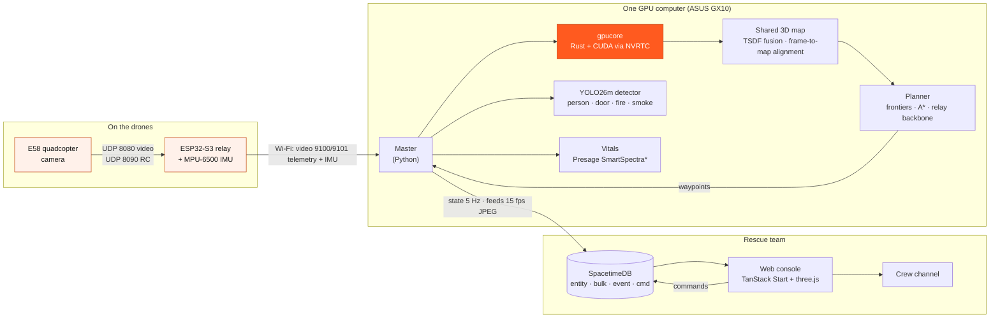

<p align="center">
  <a href="#demo-video"></a>
</p>

# Mayfly

**A swarm of cheap drones that maps a collapsed building in parallel, so rescuers know where people are before anyone goes in.**

When a building comes down, the first hour is mostly spent finding out what's inside. Today a rescue team typically sends one specialized indoor drone, flown by one pilot, room by room. Mayfly sends several small drones at once. They split the building between them, fly without a pilot each, and merge what they see into one live 3D map. The map marks people, blocked passages and hazards, and the crew gets a route.

Built at Cal Hacks 13.0.

- [Demo video](#demo-video)
- [Why this matters](#the-need)
- [What it does](#the-product)
- [How it works](#system-architecture)
- [What's real and what's simulated](#whats-real-and-whats-simulated)
- [Competition](#competition) and [market](#market-fit)
- [Hackathon tracks](#hackathon-tracks)
- [Run it](#running-it)
- [Works cited](#works-cited)

---

## Demo video

<a id="demo-video"></a>
[](#demo-video)
<!-- Replace #demo-video with the YouTube/Devpost link once uploaded. Source: video/ (Remotion). -->

3½ minutes: the problem, the product, a live walkthrough of the console, the technical design, and what's next.

---

## The need

After an earthquake or a structural collapse, rescue crews face the same question in every building: *is anyone in there, and where?*

The tools are slow for structural reasons, not because people aren't trying:

- **One drone at a time.** Specialized indoor drones are built to be flown into one building by one pilot. Mapping a whole structure means visiting every room in sequence.
- **They are expensive.** A BRINC LEMUR 2 was listed at **$29,999** per unit in a county sheriff's equipment procurement [3]. Teams usually own one or two.
- **Every minute of searching is a minute not spent rescuing.** Crews are entering unstable buildings to learn what a sensor could have told them.

Research on multi-robot exploration points the other way. A 2024 study in *Sensors* found a collaborative two-robot team cut indoor mapping time by **about 50%** [1]. A 2024 *IEEE RA-L* paper reported a **26.4%** improvement in indoor exploration with up to three aerial robots against its baseline [2]. Those are results from the cited studies, not measurements of Mayfly, but they are why we built a swarm instead of a better single drone.

There is also a responder-safety argument. Every room a drone clears is a room a firefighter doesn't have to walk into blind. That leaves crews' time and energy for the rescue itself.

## The product

<p align="center"></p>

A rescue lead uses Mayfly from a browser:

1. **Start a mission.** Look up the address and pick the incident type (earthquake, structural collapse, gas leak…). Floor plan and building records load automatically.
2. **Launch.** Check which drones are ready and pick a search pattern (for example *split by room*). Launch them all with one click.
3. **Watch the map build.** Every drone's camera feeds one shared 3D point-cloud map, with a coverage meter ("62% mapped, 2 rooms left") and each drone's path.
4. **Act on findings.** People, closed doors, blocked passages and gas cylinders appear as pins with a confidence score. A found person shows a snapshot and estimated breathing and pulse.
5. **Brief the crew.** Send a route to the crew channel ("left from the front door, first door on the left, 7 m; gas cylinder is in the kitchen, not on this route").

<p align="center"></p>

The console says what it can't do, too: cameras need light, so it's not for heavy smoke; pulse readings are estimates, not diagnoses; and the incident commander approves routes and can stop every drone.

## System architecture

The drones don't think. Each one is a cheap quadcopter with a camera and an IMU. It streams what it sees to one GPU computer and flies where it is told. All the intelligence, from mapping to planning to detection, lives in one place.



<sub>*SmartSpectra was benchmarked offline; vitals in the live simulator come from a stand-in that labels its numbers as simulated. See below.</sub>

### The pieces

| Component | Where | What it does |
|---|---|---|
| **Drone link** | `drone_control/` | Talks to an E58 toy quadcopter with the reverse-engineered `wifi_cam` protocol from Turbodrone [7]: JPEG video on UDP 8080, RC on UDP 8090. |
| **ESP32-S3 relay** | `drone_control/esp32/relay.py` | MicroPython. Joins the drone's Wi-Fi as a client and runs its own AP on the same radio. Forwards video and RC both ways and streams the MPU-6500 at 100 Hz. |
| **Simulator + master** | `sim/disaster_sim/` | Seeded buildings and survivors, quadrotor physics with cascaded PID, camera, VIO drift, depth error and a lossy ESP mesh radio. The master fuses every drone's frames into one map and plans where each goes next. |
| **gpucore** | `gpucore/` | The simulator's GPU core, written as a PyO3 extension. CUDA kernels are compiled at startup with NVRTC: voxel ray-march camera, map fusion, Gauss-Newton alignment, plane fitting, viewer streaming, radio SNR, plus a native A* planner. A PyTorch implementation remains as the reference and fallback. |
| **Detection** | `object_det/` | A YOLO26m checkpoint on Ultralytics [4][5] with four classes: fire, smoke, person, door. It runs as a ROS 2 node (`/detections`, `vision_msgs`) and as a local FP16 GPU service the simulator calls. |
| **Vitals** | `vitals/` | Benchmark of Presage SmartSpectra on clips built from real photos with injected pulse and breathing [9]. |
| **Live state** | `swarm_db/` | SpacetimeDB module (Rust → WASM) [10]. Only the simulator's identity can write state; viewers can only submit commands. |
| **Console** | `ui/apps/web` | TanStack Start, React 19, Tailwind v4 and an embedded three.js point-cloud viewer. Every browser sees the same mission state. |

### How a search plays out

```mermaid
sequenceDiagram
  participant Lead as Rescue lead
  participant UI as Console
  participant DB as SpacetimeDB
  participant M as Master + gpucore
  participant D as Drones
  Lead->>UI: Launch 4 drones
  UI->>DB: submit_cmd(launch)
  DB->>M: cmd
  M->>D: scouts take nearest frontiers; perimeter team flies the outside
  loop 20 Hz position loop, 5 Hz state
    D-->>M: IMU + JPEG frames over the mesh
    M->>M: fuse into TSDF map, align to walls/roof, detect
    M->>D: next stretch (replanned without stopping)
    M-->>DB: drones, map, findings, feeds
    DB-->>UI: live tables
  end
  M-->>DB: person found + vitals estimate
  UI->>Lead: pin, snapshot, route
  Lead->>UI: Send route to crew
```

The planner does a few things a single drone can't:

- Scouts take frontiers nearest the base first.
- Once the building is located, a perimeter team flies the outside while the rest go in through openings confirmed for 5 seconds.
- Some drones hold back as a relay backbone to keep the mesh connected.
- A forward-clear speed governor uses fresh depth, with an emergency brake and a battery return reserve.

## What's real and what's simulated

We'd rather tell you than have you find out.

| Part | Status |
|---|---|
| E58 video + IMU through the ESP32-S3 relay | **Working on real hardware.** Measured video from a direct link: 24.5–24.6 fps with 99.6–100% of frames intact. Through the S3 relay: 21.2 and 19.8 fps with 86.1% and 80.3% intact. The protocol splits each frame into about 7 chunks, so 5% packet loss costs about 30% of frames [8]. The real drone shows up in the console as a live tile. |
| Flying the real drone from code | **Built, not flown.** The flight handler (`drone_control/control/`, 49 tests) has only been tested with props off. Flight commands deliberately don't go through the database, because it has no auth for them yet. |
| Multi-drone swarm, shared map, planner | **Simulated.** Everything runs in our simulator on the GX10 with simulated VIO and a mono-depth stand-in. Plan-assisted demo mode is labelled *SIMULATION* in the viewer. |
| Object detection | **Real model.** YOLO26m runs on frames rendered by the simulator and on the live E58 stream (`live_drone_detection.py`). |
| Vitals | **Benchmarked.** When SmartSpectra accepts a clip, injected heart rate comes back within 0.5 bpm after about 12 s of warm-up. On our simulated *drone-quality* clips (shake, noise, JPEG q35) it returned `ChestNotVisible`. Live vitals in the sim are a labelled stand-in. |
| Console screens | Live from SpacetimeDB for drones, survivors, map, events and feeds. Mission setup and address search are mocked. The landing page's one-vs-many race is an illustration, not a measurement. |

## Competition

| | Mayfly | BRINC LEMUR 2 | Flyability Elios 3 | Skydio X10 |
|---|---|---|---|---|
| Form factor | Many small drones, one base computer | One specialized indoor drone | One caged inspection drone | One autonomous drone |
| Search model | Parallel: the building is split between drones | Sequential, one pilot | Sequential, one pilot | One drone per pilot |
| Unit cost | Toy-class airframes + one GPU box | $29,999 listed [3] | — | — |

The incumbents make excellent single aircraft: caged airframes that bounce off walls, lidar, ruggedized radios. We aren't trying to out-build them on one drone. Mayfly bets that for *search*, coverage per minute matters more than the capability of any one airframe, and that coverage scales with the number of drones in the air.

## Market fit

- **Who buys:** urban search and rescue teams, fire departments and county sheriffs, the same buyers who already procure single indoor drones. In the US alone FEMA's National Urban Search & Rescue Response System has 28 task forces [11], and many fire departments run their own technical rescue teams.
- **Why they'd switch:** one LEMUR 2 costs about the same as a GPU base station plus a box of small drones. When a drone is crushed in a collapse, the team loses a cheap airframe, not its only one.
- **How it fits their workflow:** it runs from a browser on the incident network, briefs the crew over the radio channel they already use, and keeps a person in charge of every route.
- **Beyond earthquakes:** welfare checks, gas leaks and post-blast assessment, any time someone needs to know what's inside before going in.

## What's next

- Real swarm flight tests: fly the E58 through the relay, then several at once.
- A Raspberry Pi relay (scripts exist and are untested) to replace the S3 and fix its frame loss.
- Live vitals from drone-quality video, by finding which degradation breaks SmartSpectra.
- Ground robots like Boston Dynamics Spot joining the same map, for rubble drones can't fly through.

## Hackathon tracks

<!-- Edit this table to match the tracks we actually submitted to on Devpost. -->

| Track | Why Mayfly fits |
|---|---|
| **Social impact / public safety** | Finds trapped people faster and keeps responders out of unsearched rooms. |
| **Hardware** | Real E58 drone, custom ESP32-S3 Wi-Fi relay with a live IMU stream, reverse-engineered RC protocol. |
| **Presage** | SmartSpectra vitals pipeline and benchmark on synthetic, real-photo-based clips (`vitals/`). |
| **SpacetimeDB** | The whole mission state, including map blobs, camera feeds, events and commands, lives in one SpacetimeDB module that every console subscribes to (`swarm_db/`). |
| **ASUS / GPU computing** | `gpucore` CUDA kernels and the YOLO26 FP16 service run on the ASUS Ascent GX10. |
| **AI / computer vision** | YOLO26m detection of people, doors, fire and smoke; TSDF map fusion; frontier planning. |

## Running it

```bash
# Simulator + 3D viewer (Python 3.11+)
cd sim && python3 -m venv .venv && .venv/bin/pip install -e ".[dev]"
.venv/bin/uvicorn disaster_sim.server:app --port 8000

# Live state through SpacetimeDB (needs the spacetime CLI and wasm32 target)
scripts/stdb-up.sh

# Web console
cd ui && bun install && bun run dev:web

# GPU core (optional; Rust + CUDA 13 driver)
cd gpucore && pip install maturin && maturin develop --release

# Object detection on the live E58 feed
./run_live_feed.sh
```

More detail lives next to the code: `gpucore/README.md`, `object_det/README.md`, `vitals/README.md`, `drone_control/control/README.md`, `drone_control/esp32/README.md`. The demo video is a Remotion project in `video/`.

## Works cited

**Research and market evidence**

1. Xia et al., *Sensors* (2024). Collaborative two-ground-robot indoor mapping experiment; about 50% less indoor mapping time.
2. Kim et al., *IEEE Robotics and Automation Letters* (2024). Up to three aerial robots compared with the paper's baseline; 26.4% improvement in indoor exploration performance.
3. Santa Clara County Sheriff's Office, equipment listing. BRINC LEMUR 2 procurement cost, $29,999 per unit.

**Technology**

4. Jocher, Glenn, et al. "Ultralytics YOLO26: Unified Real-Time End-to-End Vision Models." *arXiv*, 2 June 2026, [arxiv.org/abs/2606.03748](https://arxiv.org/abs/2606.03748).
5. Sapkota, Ranjan, et al. "YOLO26: Key Architectural Enhancements and Performance Benchmarking for Real-Time Object Detection." *arXiv*, 29 Sept. 2025, [arxiv.org/abs/2509.25164](https://arxiv.org/abs/2509.25164).
6. Lajoie, Pierre-Yves, and Giovanni Beltrame. "Swarm-SLAM: Sparse Decentralized Collaborative Simultaneous Localization and Mapping Framework for Multi-Robot Systems." *IEEE Robotics and Automation Letters*, vol. 9, no. 1, Nov. 2023, pp. 475–82, [doi.org/10.1109/lra.2023.3333742](https://doi.org/10.1109/lra.2023.3333742). Related work on collaborative multi-robot mapping.
7. Richards, Marshall, et al. *marshallrichards/turbodrone: Reverse Engineering the Best-selling Drones on Amazon to Control Programmatically*. Commit 2c09cf8, 26 June 2026, [github.com/marshallrichards/turbodrone](https://github.com/marshallrichards/turbodrone).
8. Mayfly team. *Drone link approach analysis*, `drone_control/docs/approach-analysis.md` (our own measurements).
9. Presage Technologies. SmartSpectra SDK (`@smartspectra/node-sdk` 3.4.0), [presagetech.com](https://presagetech.com).
10. Clockwork Labs. SpacetimeDB, [spacetimedb.com](https://spacetimedb.com).
11. FEMA. National Urban Search & Rescue (US&R) Response System, [fema.gov/emergency-managers/national-preparedness/frameworks/urban-search-rescue](https://www.fema.gov/emergency-managers/national-preparedness/frameworks/urban-search-rescue).
12. Cheng, Tianheng, et al. "YOLO-World: Real-Time Open-Vocabulary Object Detection." *arXiv*, 30 Jan. 2024, [arxiv.org/abs/2401.17270](https://arxiv.org/abs/2401.17270). Its weights are in the repo (`yolov8m-worldv2.pt`); the shipped detector is YOLO26m.

**Media in the demo video.** Stock footage and photos are public domain or Creative Commons. Authors and licences are listed per file in `video/public/stock/CREDITS.md`. Competitor names and logos are used only to identify products.
